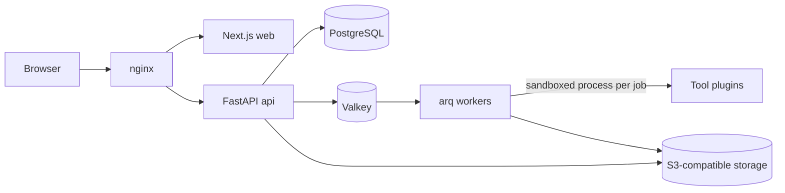

# PDFNova

A privacy-first document platform: merge, split, compress, convert, edit, sign and secure documents, with an API, workspaces and automation. The brand name is configured in `packages/shared/brand.json`.

## Architecture



- `apps/api` FastAPI service, job engine, tool plugins, Alembic migrations
- `apps/web` Next.js 16 App Router frontend with the design system
- `packages/shared` shared brand configuration
- `infra` nginx configuration
- `docs` plan, licenses, guides

See `docs/PLAN.md` for the full design and phase status.

## Quick start

```bash
make dev
```

Open http://localhost:8080. The first run creates `.env` with fresh secrets. The API validates its configuration at startup and refuses to start with a clear message if a setting is missing or inconsistent (for example `QUEUE_BACKEND=arq` without `REDIS_URL`, or insecure defaults in production).

For local development without Docker, create an API virtualenv, run `make seed` to apply migrations and create `demo@example.com` (admin, password `Sample-Passphrase-2026!`, refused in production), then run `make api` and `make web`.

| Target | Does |
|---|---|
| `make dev` | Starts the whole stack in Docker |
| `make test` | Runs API and web tests |
| `make lint` | Runs ruff, mypy, eslint, tsc and prettier |
| `make seed` | Migrates the database and creates a development admin account |

## Run with Docker

```bash
make dev
```

This creates `.env` with fresh secrets on first run and starts PostgreSQL, Valkey, SeaweedFS, the API, three workers (default, priority, office), the web app and nginx at http://localhost:8080.

## Run without Docker

Requirements: Python 3.11+ and Node.js 22.12+.

```bash
cd apps/api
python -m venv .venv
.venv/bin/pip install -e ".[dev]"
.venv/bin/python -m alembic upgrade head
.venv/bin/python -m uvicorn app.main:app --reload

cd apps/web
npm install
npm run dev
```

Without Docker the API uses SQLite, encrypted local disk storage and an in-process job queue, so no other services are needed. The web app proxies `/api` to `http://localhost:8000` (override with `API_INTERNAL_URL`). Open http://localhost:3000.

## Tests and checks

```bash
make test   # pytest + vitest
make lint   # ruff, mypy, eslint, tsc, prettier
```

## Configuration

All settings are environment variables; see `.env.example`. Key ones:

| Variable | Purpose |
|---|---|
| `SECRET_KEY` | Signs tokens, cookies and download links. Required in production. |
| `STORAGE_ENCRYPTION_KEY` | Base64 32-byte key for at-rest encryption on local storage. |
| `DATABASE_URL` | `postgresql+asyncpg://...` or `sqlite+aiosqlite:///...` |
| `QUEUE_BACKEND` | `arq` (Redis/Valkey) or `inline` (in-process) |
| `STORAGE_BACKEND` | `s3` or `local` |
| `S3_*` | Bucket, endpoint and credentials for S3-compatible storage |
| `S3_SERVER_SIDE_ENCRYPTION` | Send `AES256` SSE headers (on for AWS S3) |
| `EMAIL_BACKEND`, `SMTP_*` | `console` logs emails; `smtp` sends them |
| `GOOGLE_*`, `GITHUB_*` | OAuth sign-in; buttons appear only when configured |
| `JOB_TIMEOUT_SECONDS`, `JOB_MEMORY_LIMIT_MB` | Per-job sandbox limits |

## Free for everyone: fair-use policy

Every feature is free, with no plans, paywalls or payment code. Abuse is contained by one fair-use policy (`apps/api/app/fair_use.py`) that applies to everyone, tunable with `FAIR_USE_*` environment variables:

| Variable | Default |
|---|---|
| `FAIR_USE_MAX_FILE_BYTES` | 200 MB per file |
| `FAIR_USE_MAX_TASK_BYTES` | 2 GB per task |
| `FAIR_USE_MAX_FILES_PER_TASK` | 100 |
| `FAIR_USE_CONCURRENT_JOBS` | 4 running at once |
| `FAIR_USE_HOURLY_TASKS` / `FAIR_USE_DAILY_TASKS` | 120 / 600 |
| `FAIR_USE_AI_DAILY_REQUESTS` | 40 (unlimited with your own AI key) |
| `FAIR_USE_REQUESTS_PER_MINUTE` | 600 |
| `FAIR_USE_RETENTION_SECONDS` / `FAIR_USE_EXTENDED_RETENTION_SECONDS` | 1 hour / 24 hours |

Hitting a limit returns HTTP 429 with code `fair_use_limit` and a `reset_at` timestamp. An optional donation page exists; donating unlocks nothing.

## API

Interactive OpenAPI docs are served at `/docs`. The task flow: create a task, upload files (multipart or resumable chunked PATCH), start it with options, follow progress over Server-Sent Events, then download through signed, expiring links.
