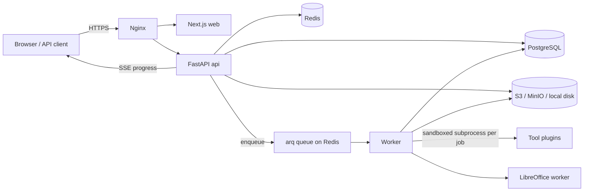

# PDFNova — Living Plan

Brand name lives in one place: `packages/shared/brand.json` (read by the API and the web app).

## Architecture



Key decisions

| Concern | Production | Local dev / tests |
|---|---|---|
| Database | PostgreSQL via asyncpg | SQLite via aiosqlite |
| Queue | arq on Redis | in-process asyncio queue (same engine code path) |
| Storage | S3 / MinIO, SSE-AES256 | local disk, AES-256-GCM framed encryption |
| Rate limit | Redis fixed window | in-memory fixed window |
| Email | SMTP | console backend (links only, never file content) |

The job engine executes every tool in a separate OS process (spawn) with a wall-clock timeout, and on Linux with `RLIMIT_AS`/`RLIMIT_CPU`/`RLIMIT_FSIZE` limits. Progress travels child → parent over a pipe and is persisted to the task row; the SSE endpoint streams task state from the database, so any API replica can serve any task's progress.

## Folder tree

```
.
├── CLAUDE.md
├── Makefile
├── README.md
├── docker-compose.yml
├── .env.example
├── .github/workflows/ci.yml
├── apps/
│   ├── api/
│   │   ├── Dockerfile
│   │   ├── pyproject.toml
│   │   ├── alembic.ini
│   │   ├── alembic/ (env.py, versions/)
│   │   ├── app/
│   │   │   ├── main.py
│   │   │   ├── fair_use.py   one fair-use policy for everyone (no plans)
│   │   │   ├── core/        config, brand, logging, security, errors, ratelimit, metrics, crypto
│   │   │   ├── db/          base, session
│   │   │   ├── models/      user, auth tokens, task, task_file
│   │   │   ├── schemas/     pydantic request/response models
│   │   │   ├── api/         deps, routes/ (health, auth, oauth, mfa, tools, tasks, uploads, files)
│   │   │   ├── services/    auth, email, oauth, quota, tasks
│   │   │   ├── storage/     base, local, s3, factory
│   │   │   ├── files/       sniffing, pdf safety checks, inspect (pikepdf), render (pypdfium2 thumbnails)
│   │   │   ├── jobs/        context, sandbox, engine, queue, worker, sweeper
│   │   │   └── tools/       base, registry, pages (range parser), pdfkit, batch, organize/, optimize/, convert/, edit/, security/, ai/, image/
│   │   └── tests/           unit + integration, fixtures generated at session start
│   └── web/
│       ├── Dockerfile
│       ├── src/app/[locale]/ App Router routes under next-intl (en, ur RTL): (site), (auth), account, tools/[slug]
│       ├── src/components/  ui/ (design system), layout/, tools/, marketing/
│       ├── src/lib/         api client, upload client, sse, utils
│       ├── src/config/      tools catalog, routes, navigation, site
│       ├── src/content/     tool copy, solutions, workflows, legal, blog MDX, API reference
│       ├── messages/        en.json, ur.json
│       ├── e2e/             Playwright specs and screenshot capture
│       └── src/styles/      tokens.css
├── packages/shared/         brand.json, generated OpenAPI TS client
├── infra/                   nginx/, libreoffice/, scripts/
├── docs/                    PLAN.md, LICENSES.md, API.md, DEPLOYMENT.md, ADDING_A_TOOL.md
└── tests/                   cross-app e2e (Playwright), load (Locust)
```

## Tool plugin interface

```python
class Tool(ABC, Generic[OptionsT]):
    slug: ClassVar[str]
    name: ClassVar[str]
    category: ClassVar[ToolCategory]
    summary: ClassVar[str]
    input_spec: ClassVar[InputSpec]
    options_schema: ClassVar[type[OptionsT]]
    uses_ai: ClassVar[bool] = False
    decrypt_inputs: ClassVar[bool] = True

    def validate_options_against_inputs(self, files: Sequence[InputFileInfo], options: OptionsT) -> None: ...

    def estimate_cost(self, files: Sequence[InputFileInfo], options: OptionsT) -> CostEstimate: ...
    @abstractmethod
    def run(self, ctx: JobContext[OptionsT]) -> list[OutputFile]: ...
```

`InputSpec` declares min/max files, accepted file kinds and per-file max bytes (the fair-use policy further restricts). `JobContext` gives the tool a private work dir, local input paths, validated options, `report(fraction, label)` and `ensure_not_cancelled()`. Registration is automatic: every module under `app/tools/` that defines a concrete `Tool` subclass is discovered at startup. The web app mirrors tools in `src/config/tools.ts` and fetches option schemas from `/api/v1/tools`.

## Task API flow

1. `POST /api/v1/tasks` `{tool}` (+ `Idempotency-Key`) → task
2. `POST /api/v1/tasks/{id}/uploads` `{filename, size}` → upload with chunk size
3. `PATCH /api/v1/uploads/{id}` with `Upload-Offset` header and raw chunk; `HEAD` returns current offset (resumable)
4. `POST /api/v1/tasks/{id}/start` `{options, file_order}` → queued
5. `GET /api/v1/tasks/{id}/events` (SSE) → progress, status
6. `GET /api/v1/tasks/{id}` → outputs with signed expiring download URLs
7. `DELETE /api/v1/tasks/{id}` → instant delete; sweeper deletes expired tasks by TTL

## Phase checklist

### Phase 1 — Foundation (complete, 2026-11-19)
- [x] Monorepo, brand constant (`packages/shared/brand.json`), Makefile, .env.example
- [x] Docker stack authored: api, worker, worker-priority, office-worker (LibreOffice), web, postgres, valkey, seaweedfs, nginx. Not executed on this workstation (no Docker); CI builds both images and validates compose.
- [x] FastAPI skeleton: config, structlog with redaction, error envelope with hints, CSP/HSTS headers, CSRF double-submit, Prometheus metrics, Sentry hook, live/ready health
- [x] DB models + Alembic migration (upgrade/downgrade tested on SQLite; PostgreSQL in CI)
- [x] Auth: register, verify email, login with lockout, refresh rotation with reuse detection, logout, reset/change password, TOTP 2FA + recovery codes, Google (PKCE) and GitHub OAuth with pre-hijack protection
- [x] Storage: AES-256-GCM framed encrypted local disk, S3 with configurable SSE and presigned downloads
- [x] Job engine: tasks, resumable chunked + multipart uploads, sniffing, zip/PDF bomb guards, inline and arq queues with retries and dead-lettering, spawn sandbox with rlimits/timeout/cancel, SSE progress, signed expiring downloads, ZIP bundling, TTL sweeper, stuck-job reaper, instant delete
- [x] Usage limits + enforcement (replaced by the fair-use policy in Phase 1B), idempotency keys
- [x] Tool plugin framework with auto-discovery + Merge PDF (page ranges, rotation, bookmarks, outline preservation)
- [x] Backend: 87 tests, 90% coverage, ruff and mypy strict clean
- [x] Next.js 16 shell, tokens with dark mode, base components (button, input/field, card, badge, dialog, toaster, progress, skeleton, dropzone), landing page, tool workspace (upload, options, SSE progress, result, delete now), auth pages, 404/error states, proxy-level 404 for unknown tools
- [x] Web: 30 tests, eslint, tsc, prettier clean, production build succeeds
- [x] CI workflow (api, web, docker)
- [x] docs/LICENSES.md, docs/ADDING_A_TOOL.md, README.md

Phase 1 notes carried forward:
- Testimonials section intentionally omitted until real customer quotes exist.
- Tool option panels are per-tool React components; Phase 2 adds thumbnails and drag-and-drop reordering.

### Phase 1B — Free for everyone + frontend upgrade
- [x] Plans, pricing and payment code removed; `app/fair_use.py` with `FAIR_USE_*` env vars; 429 `fair_use_limit` with `reset_at`
- [x] Optional donation page (unlocks nothing); bring-your-own AI key bypasses the shared AI allowance
- [x] Redesigned site: home, all tool pages, solutions, workflows, legal, blog (MDX), changelog, API reference, contact, account pages, command palette
- [x] next-intl with English and Urdu (RTL), proxy-level 404s for unknown paths
- [x] Guest file names erased and guest tasks purged after 48 h, matching the privacy policy
- [x] Playwright e2e suite (10 tests)
- [x] Docs updated (PLAN, CLAUDE.md, README fair-use section, LICENSES)
- [x] Lighthouse run on home and Merge, recorded in docs/LIGHTHOUSE.md; hydration bug and canonical fixed
- [ ] Mobile Lighthouse performance below 90 (open, see docs/LIGHTHOUSE.md)
- [ ] Full screenshot set re-captured and reviewed

Phase 1B has no payments anywhere; Phase 6 no longer includes billing.

### Phase 2 — Core PDF tools

Working rule: each tool is a vertical slice (backend, option panel, PageGrid/thumbnails/password prompt where relevant, Urdu strings, tools-content entry, Playwright e2e). A tool shows as Live only after its e2e passes. Every PDF output in tests passes `qpdf --check`.

| Item | Backend | Frontend slice | E2E / Live |
|---|---|---|---|
| Page-expression parser + Hypothesis tests | Done | n/a | n/a |
| Inspect service + endpoint | Done | Done (password unlock) | n/a |
| Thumbnail service + endpoints | Done | Done (PageGrid, lazy IntersectionObserver) | n/a |
| Sealed per-job passwords | Done | Done (per-file prompt, cleared after start) | e2e passes |
| Batch runner with failure report | Done | n/a | n/a |
| PageGrid, PageRangeInput | n/a | Done, Vitest | n/a |
| Result screen with chaining | Done (POST /tasks/{id}/chain) | Done, no re-upload | e2e passes |
| Rotate | Done | Done | Live, e2e passes |
| Remove pages | Done | Done | Live, e2e passes |
| Extract pages | Done | Done | Live, e2e passes |
| Split | Done | Done | Live, e2e passes |
| Organize | Done | Done | Live, e2e passes |
| Merge upgrade (thumbnails, passwords, page-level mode) | Live from Phase 1, upgrade not started | Not started | Live (Phase 1) |
| Compress, Repair, Page numbers, Watermark, Crop, Protect, Unlock, Flatten, Metadata | Not started | Not started | Not live |
| docs/PERFORMANCE.md | Batch 1 measured | | |
| screenshots/phase2 | Batch 1 captured (20) and reviewed | | |
| Urdu tool page content (steps, highlights, FAQ) | n/a | Done for all live tools (tools-content.ur.ts); CI test fails if a live tool lacks complete Urdu | |

### Phase 3 — Conversion suite
### Phase 4 — Editor and signing
### Phase 5 — AI features
### Phase 6 — Platform
### Phase 7 — Hardening

## Environment notes (this workstation)

Docker, Tesseract and LibreOffice are not installed locally (qpdf 12.4.2 is, via winget, for `qpdf --check` in tests), so the compose stack is authored but verified only in CI/servers; local tests use SQLite + local storage + inline queue. Local Python is 3.11; code stays 3.11-compatible while images use 3.12.
